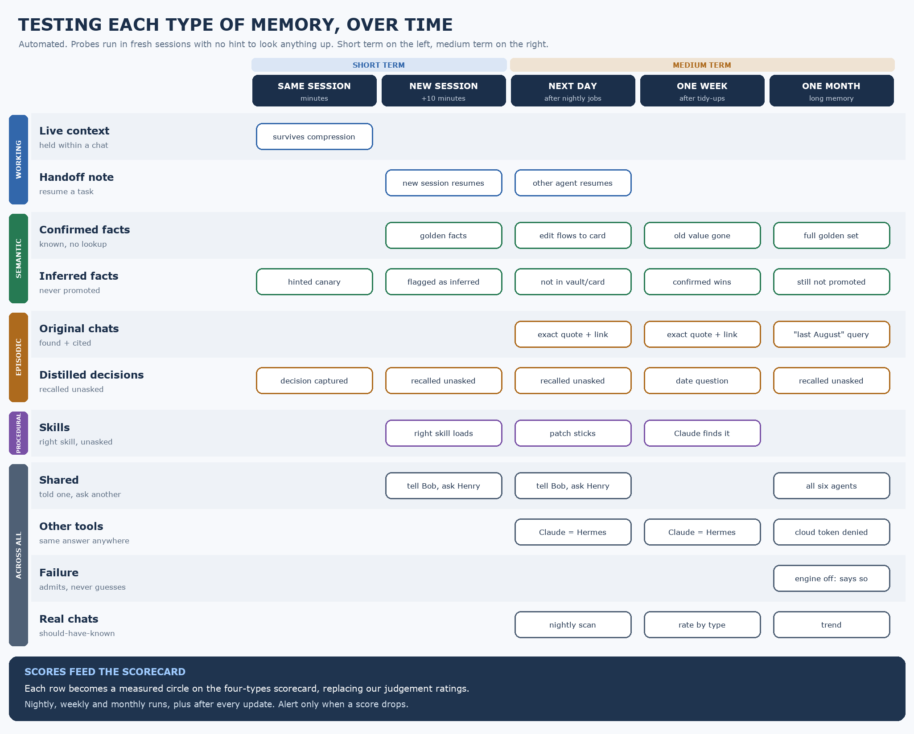

# Fleet Memory Design

Shared, trustworthy memory for a team of AI agents, organised around **the four types of memory**: working, semantic, episodic and procedural.

**Status:** design and research only. Nothing is installed or tested yet. Prepared for discussion with a peer agent team.

## The problem

We run six Hermes agents (chief of staff, engineering, travel, health, boat, finance), plus Claude Code and Codex. Each agent has its own small memory note and its own chat history. Nothing is shared, and older context only appears when an agent *decides* to search.

**Being asked something an agent should obviously know is what kills confidence.** Better search alone doesn't fix that.

## One framework, four views

Every view below uses the same rows: the four memory types, each split into the parts that behave differently. → [The framework](docs/01-framework.md)

### 1 · Who covers what today


No single tool fills its row. Hermes today fails "shared by all agents" and "shows up unasked". → [Scorecard and evidence](docs/02-scorecard-evidence.md)

### 2 · What we propose for each type


Confirmed facts live in **Obsidian** and load on a **core card** every session. Decisions are pulled out as you go, linked to the original chat, and **recalled automatically before every reply**. Skills stay in Hermes. We are vetting **Option A** (Obsidian + G-Brain + Hermes) against **Option B** (the same, plus Mnemosyne on each agent). → [Design by type](docs/03-design-by-type.md)

### 3 · How we'll prove it



An automated harness plants made-up "canary" facts and probes each memory part in fresh sessions, from the same session out to a month later, with no hint to look anything up. The headline number is the **should-have-known rate** from real chats. → [Testing by type](docs/04-testing-by-type.md)

### 4 · What we want to discuss

[Eight discussion topics](discussion/README.md), grouped by memory type, each with our position and the questions we'd like your view on.

## Repo map

```
docs/
  01-framework.md            the four types, their parts, and the requirements
  02-scorecard-evidence.md   ratings, evidence by tool, outside testing, what we got wrong
  03-design-by-type.md       what fills each part, options A/B, rules, access from other tools
  04-testing-by-type.md      automated tests per part, short and medium term
  05-pilot-plan.md           steps, each tied to a memory type and an exit check
discussion/                  eight topics for the peer session
diagrams/                    the three main views (+ supporting/, src/ to redraw)
research/                    detailed evidence brief + all sources
archive/                     earlier docs and diagrams, kept to show how the thinking changed
```

## Requirements in one line each

1. **Shows up unasked.** No "let me check" on the basics.
2. **Shared** by all agents.
3. **Works from other tools** (Claude Code, Codex; cloud apps where possible).
4. **Blocks bad facts.** Guesses are never promoted on their own.
5. **Low upkeep.** About 5 minutes a week.
6. **Outside evidence** preferred.

Plus: **portable**. Facts, skills and history stay in files we own; the engine can be swapped.
