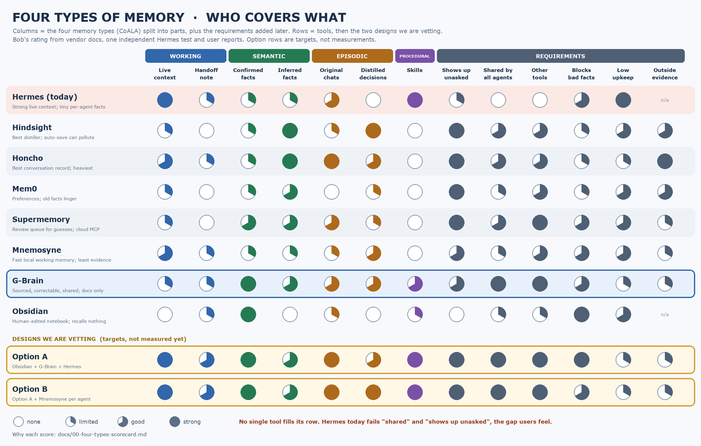
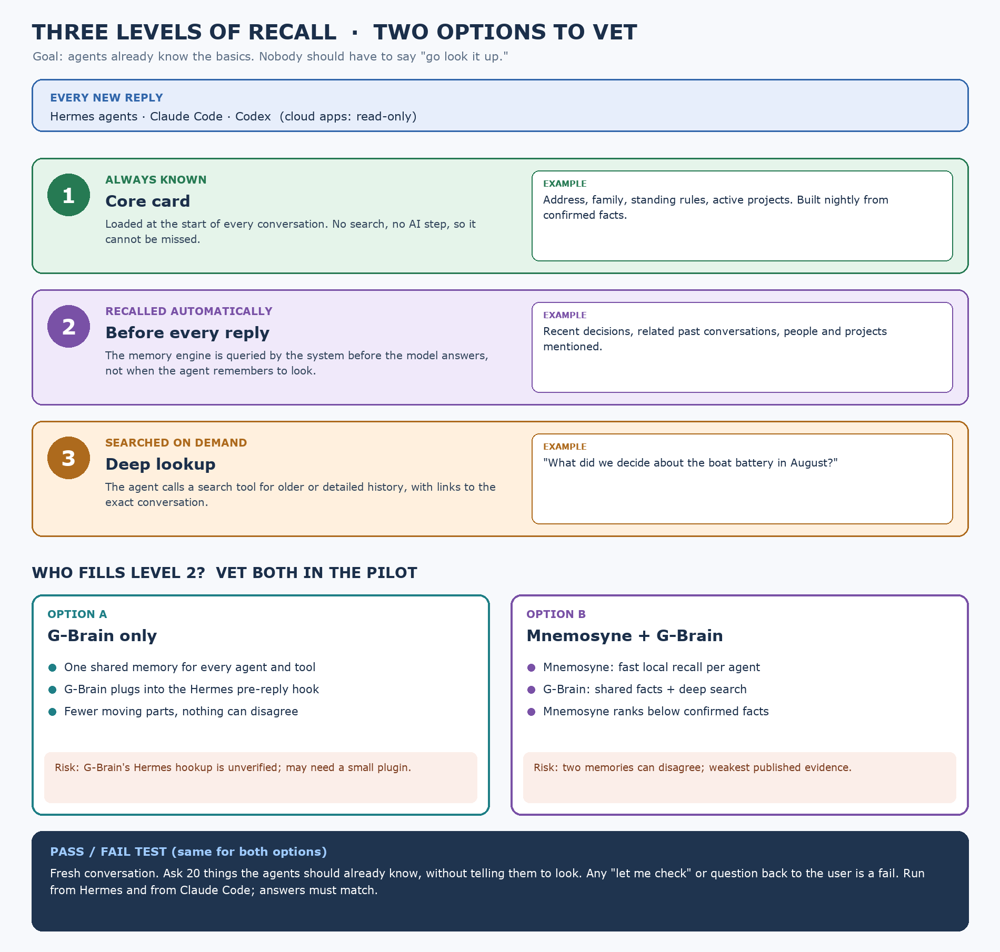

# Fleet Memory Design

A design for shared, trustworthy memory across a team of AI agents. The agents should already know the basics (who you are, where you live, what was decided last week) without being asked to go look things up.

**Status:** design and research only. Nothing has been installed or tested yet. Prepared for discussion with a peer agent team.

## The problem

We run six Hermes agents (chief of staff, engineering, travel, health, boat, finance), plus Claude Code and Codex. Today:

- Each agent has its own small memory note (about 2,200 characters) and its own chat history. Nothing is shared.
- An agent only finds older context when it *decides* to search. When it doesn't, it asks the user things it should already know.
- **Being asked something an agent should obviously know is what kills confidence.** Better search alone doesn't fix that; it only helps once someone says "go look it up."

## Requirements

1. **Agents already know the basics.** No "let me check" for core facts.
2. **One memory shared** by all six agents and outside tools (Claude Code, Codex; later Sesame, Grok bots, Muse, Dot where possible).
3. **High trust.** Changed facts replace old ones, answers can point to their source, and bad facts don't get locked in.
4. **Low upkeep.** About 5 minutes a week from the human.
5. **Portable.** Facts, skills and history stay in files we own, so the memory engine can be swapped.

## The four types of memory (start here)

The design is organised around the four standard memory types (working, semantic, episodic, procedural), each split into the parts that behave differently, and scored against our requirements. Full mapping, evidence and tests for each type: [docs/00-four-types-scorecard.md](docs/00-four-types-scorecard.md).

## Proposed design, in short

- **Source of truth:** an **Obsidian vault** of confirmed facts, in plain Markdown, edited by people and kept in git. Everything else is built from it or indexed alongside it.
- **Level 1, always known:** a short "core card" built nightly from the Obsidian vault and loaded into every conversation. No search, so it can't be missed.
- **Level 2, recalled automatically:** a memory engine queried by the system **before every reply**, not when the agent remembers to look.
- **Level 3, searched on demand:** deep search of older history, linked to the exact conversation.

We are vetting **two options for level 2:**
- **Option A:** G-Brain only, one shared memory.
- **Option B:** Mnemosyne for fast per-agent recall, plus G-Brain for shared facts and deep search.

Both are judged by the same **automated test suite**. It plants made-up "canary" facts and probes every level 10 minutes, a day, a week and a month later. It also tracks how often agents ask about things they should already know.

## Reading order

0. [docs/00-four-types-scorecard.md](docs/00-four-types-scorecard.md): **master view**, the design by memory type, with evidence and tests
1. [docs/01-design.md](docs/01-design.md): the recommended design, config layers and trust rules
2. [docs/02-options-to-vet.md](docs/02-options-to-vet.md): Option A vs Option B, and how we'll decide
3. [docs/03-research-findings.md](docs/03-research-findings.md): what the research says, including what we got wrong at first
4. [docs/04-network-access.md](docs/04-network-access.md): Tailscale vs Cloudflare for outside tools
5. [docs/05-pilot-plan.md](docs/05-pilot-plan.md): pilot scope and pass/fail tests
6. [docs/06-discussion-questions.md](docs/06-discussion-questions.md): questions for the peer team
7. [docs/07-test-methodology.md](docs/07-test-methodology.md): automated tests for every level, over short and medium timeframes
8. [research/evidence-brief-2026-10-13.md](research/evidence-brief-2026-10-13.md): the detailed, source-linked research brief
9. [research/sources.md](research/sources.md): every source, grouped by type and confidence

## Supporting views

- [Outcome scorecard](diagrams/memory-scorecard-v2.png): earlier outcome-only view, superseded by the four-type scorecard above
- [Config layers](diagrams/memory-config-layers.png)
- [Test timeline](diagrams/memory-test-timeline.png)

## How the thinking changed

`diagrams/earlier/` keeps the superseded diagrams in order. The main correction: our first scorecard rated features, which made Hermes look strong. Rated on whether memory shows up without being asked, it was the weakest. See [docs/03-research-findings.md](docs/03-research-findings.md#what-we-got-wrong-first).
