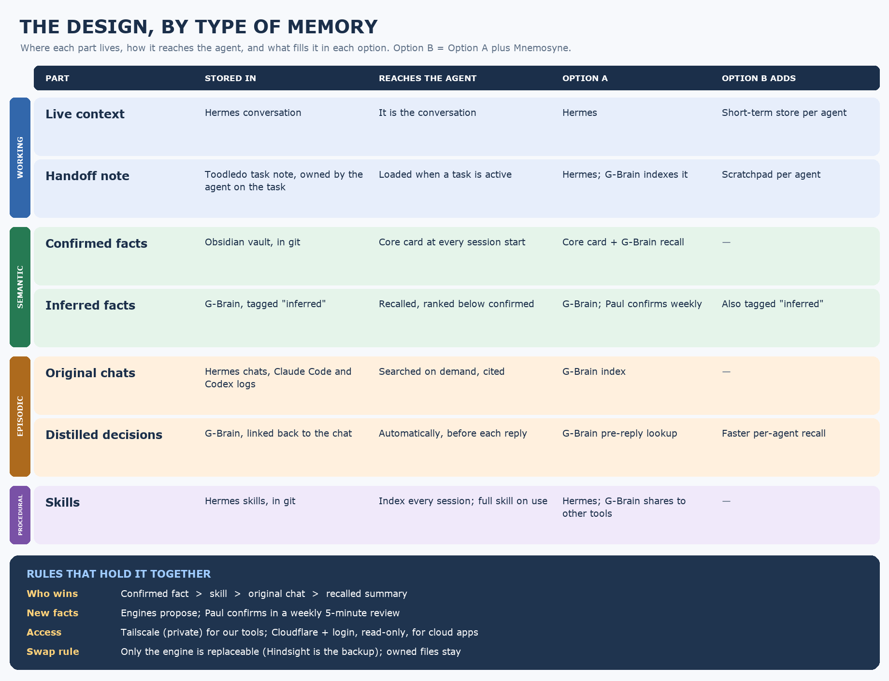

# Round 2 · What fills each part of memory

**Purpose:** choose one component for every row of the design. This is the main round.

---

## Working memory

### D2.1 · Handoff note

**Proposal:** the **Toodledo task note** is the handoff. The agent working the task writes it at the end of each session (status, blockers, next step, links). It's loaded at session start when the task is active, and indexed by the memory engine so other agents and tools can find it.

| Option | For | Against |
|---|---|---|
| **a. Task note (default)** | Already in use; owned; readable by people | Needs a small "write handoff at session end" step |
| b. Memory engine stores it | No extra step | No product ships a handoff format; one more thing to trust |
| c. Markdown file per task in the vault | Portable; in git | Duplicates the task system |

**Decide:** a, b or c? Who writes it: the agent itself, or an end-of-session hook?

---

## Semantic memory

### D2.2 · Home for confirmed facts

**Proposal:** an **Obsidian vault** (plain Markdown, in git), one note per subject (people, places, boat, standing rules). Only people, or an agent acting on a person's explicit confirmation, write to it.

**Alternatives:** (b) G-Brain's own store as the source of truth; (c) a database table.

**Why the default:** readable and editable by a human, versioned, survives any engine swap.

### D2.3 · The core card

**Proposal:** a nightly job builds a **core card** of at most **1,500 characters** from vault notes tagged `core`. It's loaded into every session for every agent, with no search. Each agent also gets a short role-specific section (≤ 500 characters).

**Decide:** card size; nightly vs on-change rebuild; one shared card or shared + per-agent section.

### D2.4 · Inferred facts

**Proposal:** facts an engine works out are stored **tagged "inferred"** and ranked below confirmed facts. Once a week, a list of new inferred facts goes to the human. Ticked items are promoted to the vault; everything else expires after 90 days.

**Alternatives:** (b) auto-promote after N consistent mentions; (c) don't store inferred facts at all.

**Why the default:** every engine in the independent test repeated planted false claims, so a human gate is the only proven block.

---

## Episodic memory

### D2.5 · When decisions are captured

**Proposal:** the engine pulls out decisions and facts **after each turn**, dated and linked to the original message. The original is never replaced.

| Option | For | Against |
|---|---|---|
| **a. Per turn (default)** | Freshest; LongMemEval-backed | Most model calls |
| b. End of session | Cheaper; more context per extraction | Lost if a session never ends cleanly |
| c. Nightly batch | Cheapest | Up to a day stale |

### D2.6 · Automatic recall engine (the big one)

**Proposal:** pilot **both** on cloned test profiles for 30 days.
- **Option A:** G-Brain fills the Hermes pre-reply memory slot.
- **Option B:** Mnemosyne fills the slot on each agent, with G-Brain behind it for shared facts and deep search.
- **A tie goes to A.** Backup engine if G-Brain fails: Hindsight.

**Decide:** agree to the A/B pilot, or pick one now based on first-hand experience. **Has anyone run G-Brain with Hermes in the pre-reply slot?** If so, that answer may settle this.

### D2.7 · Original chats

**Proposal:** Hermes chats stay where they are. Claude Code and Codex logs are imported nightly. The engine indexes everything with keyword search first, and adds local embeddings only if deep-search tests miss their target.

---

## Procedural memory

### D2.8 · Skills

**Proposal:** skills stay as Hermes skills in git, with no change. The memory engine indexes them so Claude Code and Codex can find them. Skills are patched only after a real success or failure, with the reason noted.

**Decide:** accept, or move skills into the shared engine as the source of truth?

---

**Reply format:** `D2.x ACCEPT | AMEND: … | REJECT: …`
