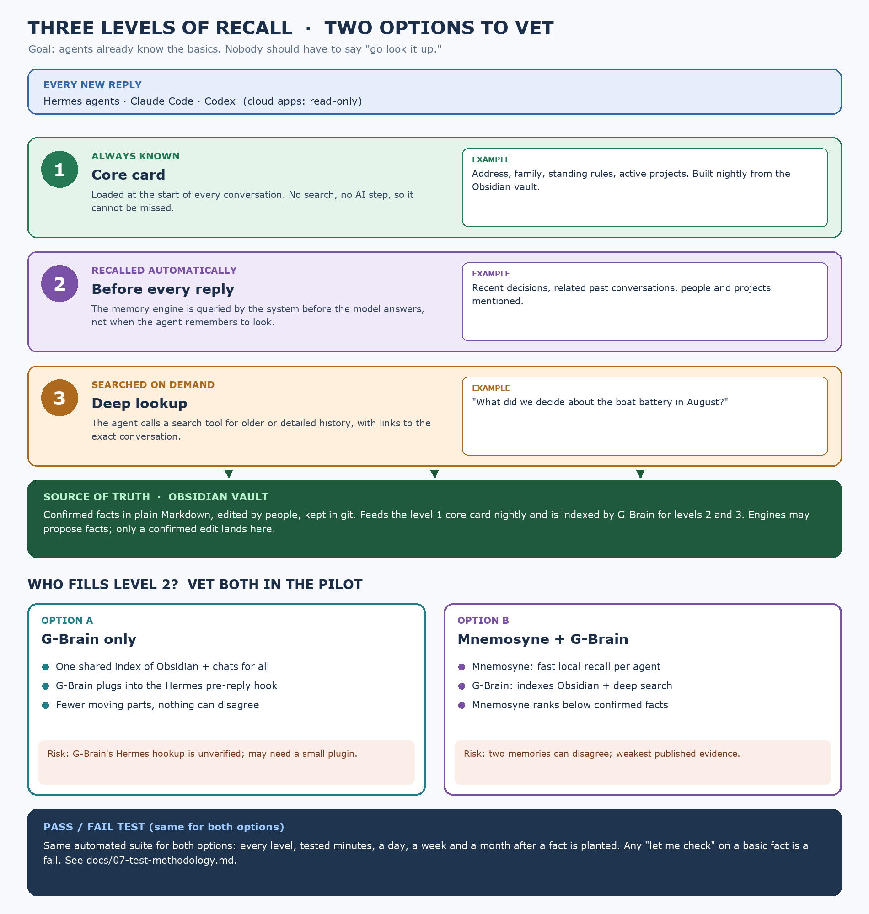

# 03 · The design, by type of memory

**Principle: owned core, swappable engine.** Facts, skills and history live in plain files we control. The memory engine indexes and recalls them, but is never the only copy of anything.

## Working memory

- **Live context:** the Hermes conversation. Option B adds Mnemosyne as a short-term store on each agent.
- **Handoff note:** the **Toodledo task note**, owned by the agent working the task.
  - Loaded at session start when the task is active.
  - Indexed by G-Brain so other agents and tools can pick it up.
  - *Why:* no product ships a handoff contract, so it has to be an owned artifact.

## Semantic memory

- **Confirmed facts:** the **Obsidian vault** (plain Markdown, in git).
  - A nightly job builds a short **core card** from it (address, family, standing rules, active projects).
  - The core card is loaded at the start of **every** conversation. No search or AI step, so it can't be missed.
  - G-Brain also indexes the vault for recall.
  - *Why:* every engine tested sometimes repeated planted false claims, so basic facts can't depend on an engine.
- **Inferred facts:** stored in G-Brain, tagged **inferred**, ranked below confirmed facts.
  - Promoted to the vault only after a person confirms, in a weekly 5-minute review.

## Episodic memory

- **Original chats:** Hermes chats plus Claude Code and Codex logs (imported nightly). Indexed by G-Brain; searched on demand; answers cite the exact conversation.
- **Distilled decisions:** pulled out **as each conversation happens**, dated, and linked back to the original chat.
  - **Recalled automatically before every reply**, triggered by the system, not by the agent remembering to look.
  - *Why:* LongMemEval's extract-as-you-go and dating results. Linking back keeps one bad extraction from becoming the truth.

## Procedural memory

- **Skills:** Hermes skills in git. The skill index loads every session; the full skill loads when used.
- Skills are patched after real wins and mistakes. G-Brain shares them with other tools.
- *Why:* no memory product does procedural memory well.

## Two options to vet

| | Option A | Option B |
|---|---|---|
| What | Obsidian + G-Brain + Hermes | Option A + Mnemosyne on each agent |
| Automatic recall from | G-Brain, before each reply | Mnemosyne (fast, local, per agent), with G-Brain behind it |
| For | One memory, nothing can disagree; less to run | Faster recall; Mnemosyne's Hermes plugin is a known path |
| Against | G-Brain filling the Hermes pre-reply slot is **unverified**; may need a small plugin | Two memories can disagree; one more component per agent; weakest evidence |
| Tie-break | **Wins ties** | Must clearly beat A on "shows up unasked" without failing the bad-facts tests |

## Rules

- **Who wins:** confirmed fact > skill > original chat > recalled summary.
- **New facts:** engines propose; a person confirms.
- **Sensitive facts** are tagged private and stay on the private network.
- **Swap rule:** only the engine is replaceable. Hindsight is the backup; Honcho if multi-party history becomes the gap.

## Access from other tools

- **Tailscale Serve (private):** our agents, Claude Code, Codex and phones.
- **Cloudflare Tunnel + Access (public, with login):** cloud apps (Sesame, Grok bot), **read-only, non-sensitive** facts only.
- **Not Tailscale Funnel:** it's public with no login.
- **Connecting a tool lets it read memory.** It doesn't send its conversations back; that needs an import job. Every product reviewed works this way.

| Tool | Read memory | Feeds conversations back |
|---|---|---|
| Hermes agents | Yes | Yes |
| Claude Code, Codex | Yes (MCP) | Yes, via nightly log import |
| Self-built Grok bot (xAI API) | Yes (remote MCP) | Only if we build it |
| Sesame | Read-only at best; login untested | No |
| Muse, consumer Grok, Dot | Unconfirmed | Unconfirmed |

Config-layer view: [../diagrams/supporting/config-layers.png](../diagrams/supporting/config-layers.png)
